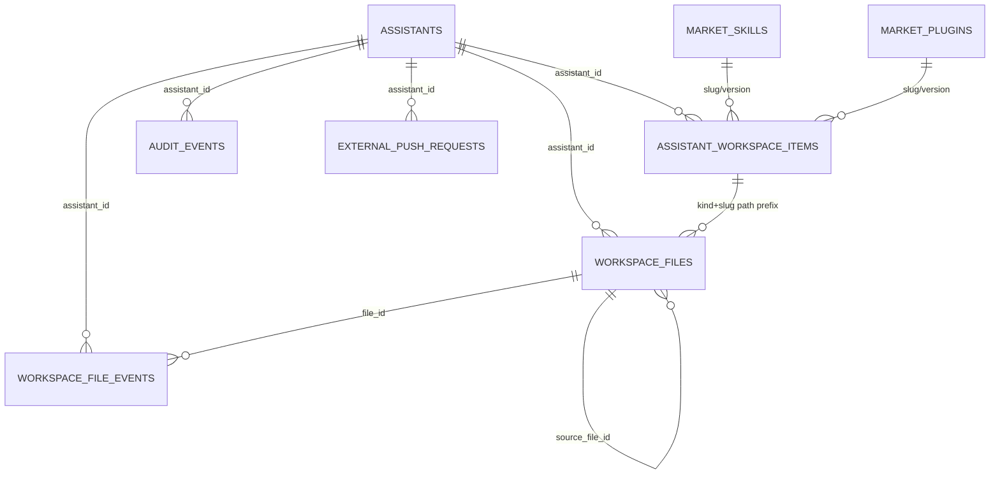

# 助手容器 workspace 元数据与后台管理平台持久化字段映射表

更新时间：2026-05-27

刷新时间：2026-06-11（对照 migration 025 与当前代码核对：补充 `workspace_files` 活跃路径唯一约束 `active_path_key` 的归一化去重逻辑及 `owner_user_id` 字段）

## 1. 范围说明

本文整理当前工作区里“workspace 元数据”和“后台管理平台持久化数据”之间的字段关系。默认后端为 MySQL；显式 `IRON_AGENT_WORKSPACE_FILE_METADATA_BACKEND=sqlite` 时才使用共享 SQLite fallback。

当前本地代码和数据体现的是三层存储：

| 层级 | 存储位置/表 | 归属 | 作用 |
|---|---|---|---|
| 助手工作区文件元数据 | MySQL: `workspace_files`, `workspace_file_events`（默认）；SQLite fallback: `data/workspace.db` | 控制面写入；显式 sqlite fallback 时运行态容器共享读取 | 描述助手工作区里的文件、能力包文件、同步状态、文件事件 |
| 后台已安装能力索引 | `data/workspace_item_index.db`：`assistant_workspace_items` | 后台管理平台 | 支撑“已安装能力”列表、启停、删除、复用、运行态 reload 状态 |
| 后台业务持久化 | `assistants`, `market_skills`, `market_plugins`, `audit_events`, `external_push_requests` 等 | 后台管理平台数据库（部分旧 JSON fallback 仍保留） | 保存助手主记录、市场包、审计、外部推送请求等业务状态 |

注意：

- 当前实际实现没有落地一个名为 `assistant_capability_installs` 的表。近期设计讨论里出现过这个名字，但当前代码实际使用 `assistant_workspace_items` 保存“已安装能力”持久状态。
- 当前 checkout 已完成 IronAgent 命名迁移，运行配置字段统一为 `iron_agent_config`。本文按数据库关系说明为主。
- 本机当前没有 `docker`/`kubectl`，因此本文没有进入 live 容器直接查库；字段以当前代码 schema、本地 SQLite 实表和后台模型为准。

## 2. 总体关系图

核心关系：

| 关系 | 说明 |
|---|---|
| `assistants.assistant_id` -> `workspace_files.assistant_id` | 一个助手拥有多条工作区文件元数据。 |
| `assistants.assistant_id` -> `workspace_file_events.assistant_id` | 一个助手拥有多条文件操作事件。 |
| `assistants.assistant_id` -> `assistant_workspace_items.assistant_id` | 一个助手拥有多个已安装能力。 |
| `workspace_files.file_id` -> `workspace_file_events.file_id` | 一个文件可以产生多条上传、同步、删除、扫描等事件。 |
| `workspace_files.source_file_id` -> `workspace_files.file_id` | 派生文件、覆盖文件、结果文件可以指向来源文件。 |
| `assistant_workspace_items.kind` -> `workspace_files.bucket` | 能力包文件里 `kind=skills/plugins` 对应文件表里的 `bucket=skills/plugins`。 |
| `assistant_workspace_items.slug` -> `workspace_files.relative_path` | 能力包 `slug` 对应文件路径前缀，例如 `skills/office-docs/...`。 |
| `market_skills.slug/version` -> `assistant_workspace_items.slug/version` | skill 市场包安装后，名称、版本、slug 同步到已安装能力索引。 |
| `market_plugins.slug/version` -> `assistant_workspace_items.slug/version` | plugin 市场包安装后，名称、版本、slug 同步到已安装能力索引。 |
| `audit_events.assistant_id` -> `assistants.assistant_id` | 安装、卸载、reload、生命周期等后台动作写审计。 |

## 3. `workspace_files` 字段映射

用途：记录助手工作区中每个文件的元数据。普通上传文件、结果文件、能力包文件都会落到这个表。

主键/约束：

- 主键：`file_id`
- 唯一活跃路径约束（两侧实现不同）：
  - 容器 SQLite：部分唯一索引 `idx_workspace_files_active_path_unique ON (assistant_id, bucket, filename) WHERE deleted = 0`，按原始三元组约束；建索引前会按同口径去重历史重复活跃行（每组保留 `updated_at` 最新一行，其余标记 `deleted=1`）。
  - 后台库：migration 025 新增 `active_path_key` 列 + 唯一索引 `uq_workspace_files_active_path`。键值为归一化后 `assistant_id\0bucket\0filename` 的 sha256（归一化：各分量去首尾空白；`filename` 反斜杠转 `/`、去前导 `/`）；`deleted=1` 或任一分量归一化后为空时键为 `NULL`，不参与唯一约束。025 迁移按**归一化键**（而非原始 `filename`）去重存量活跃行，原始不同但归一化相同的路径（如 `a.txt` 与 `/a.txt`）会归并为一行，其余标记 `deleted=1`。
- 常用查询索引：`assistant_id`, `assistant_id + bucket`, `assistant_id + deleted + updated_at`, `source_file_id`, `storage_status`, `relative_path`

| 中文含义 | 助手容器 SQLite 字段 | 后台持久化字段 | 映射关系与说明 |
|---|---|---|---|
| 文件 ID | `file_id` | `file_id` | 主键。事件表通过 `workspace_file_events.file_id` 关联。 |
| 助手 ID | `assistant_id` | `assistant_id` | 关联 `assistants.assistant_id`，所有工作区文件按助手隔离。 |
| 工作区分区/桶 | `bucket` | `bucket` | 可取 `temp`, `persistent`, `skills`, `plugins`。能力包文件使用 `skills/plugins`。 |
| 文件名/相对文件名 | `filename` | `filename` | 当前实现里常保存 bucket 下的相对文件名，例如 `111/SKILL.md`。 |
| 运行态相对路径 | `relative_path` | `relative_path` | 通常带 bucket 前缀，例如 `skills/111/SKILL.md` 或 `persistent/a.md`。 |
| 文件流向 | `direction` | `direction` | `inbound` 表示外部进入助手，`outbound` 表示助手产出。SQLite 与后台字段一致。 |
| 文件角色 | `file_role` | `file_role` | `input`, `output`, `result`。用于区分输入文件、普通输出、任务结果文件。 |
| 来源文件 ID | `source_file_id` | `source_file_id` | 可为空。用于记录派生/覆盖/结果文件的来源文件。 |
| 归属用户 ID | `owner_user_id` | `owner_user_id` | 文件归属用户。旧载荷里的 `user_id` 读取时会归一到此字段。 |
| 文件大小 | `size_bytes` | `size_bytes` | 字节数。SQLite 为 `INTEGER`，后台为 `BigInteger`。 |
| MIME 类型 | `content_type` | `content_type` | 如 `text/markdown`, `application/pdf`。 |
| 上传用户 ID | `uploader_user_id` | `uploader_user_id` | 记录发起上传的用户；系统同步或扫描时可为空。 |
| 来源类型 | `source_type` | `source_type` | 例如 `webui-chat`, `capability_package`, `scan`。旧别名 `origin` 会归一到此字段。 |
| 来源引用 | `source_ref` | `source_ref` | 保存来源请求、任务、外部系统引用等。 |
| 活跃路径键 | 无直接字段 | `active_path_key` | 后台字段（migration 025）。归一化 `assistant_id+bucket+filename` 的 sha256，承载唯一索引 `uq_workspace_files_active_path`；`deleted=1` 时为 `NULL`。容器 SQLite 无该列，同语义由部分唯一索引 `idx_workspace_files_active_path_unique` 按原始三元组保证。 |
| 存储提供方 | 无直接字段 | `storage_provider` | 后台模型字段。SQLite 不存该字段，读取时可由 `storage_backend` 推导：`cos/obs` 保持原值，其他视为 `local`。 |
| 存储后端 | `storage_backend` | `storage_backend` | 如 `local`, `cos`, `obs`。旧值 `disk` 读取时归一为 `local`。 |
| 存储 key | `storage_key` | `storage_key` | 对象存储 key 或本地存储 key。为空时可回退使用 `object_key`。 |
| 存储路径 | `storage_path` | `storage_path` | 物理/逻辑存储路径。旧别名 `workspace_path` 会归一到此字段。 |
| 存储状态 | `storage_status` | `storage_status` | 如 `pending`, `synced`, `failed`, `stored`, `uploaded`。 |
| 存储错误 | `storage_error` | `storage_error` | 存储层错误信息。读取时会和 `sync_error`, `last_error` 互相兜底。 |
| 对象 key | `object_key` | `object_key` | 对象存储层 key。为空时可由 `storage_key` 兜底。 |
| 对象 URL | `object_url` | `object_url` | 对象访问 URL 或路径。旧别名 `storage_url` 会归一到此字段。 |
| 校验和 | 无直接字段 | `checksum` | 后台模型兼容字段。应用模型中 `checksum_sha256` 属性实际读写 `checksum`。 |
| SHA256 校验和 | `checksum_sha256` | `checksum_sha256` | SQLite 的实际校验字段。写 SQLite 时来自应用模型 `record.checksum`。 |
| 扫描指纹 | `scan_fingerprint` | `scan_fingerprint` | 用于 workspace 扫描/增量同步判定文件是否变化。 |
| 同步状态 | `sync_status` | `sync_status` | 文件同步到工作区、对象存储或元数据索引的状态。 |
| 同步错误 | `sync_error` | `sync_error` | SQLite 和后台都有字段；应用模型里也通过 `last_error` 兼容读取。 |
| 最近错误 | `last_error` | `last_error` | 聚合后的最后错误。读取优先级通常为 `last_error` -> `sync_error` -> `storage_error`。 |
| 工作区最后修改时间 | `workspace_last_modified_at` | `workspace_last_modified_at` | 运行态文件系统观测到的修改时间。SQLite 为 ISO 文本，后台为带时区时间。 |
| 最后同步时间 | `last_synced_at` | `last_synced_at` | 元数据或对象存储同步完成时间。 |
| 创建时间 | `created_at` | `created_at` | SQLite 为 ISO 文本，后台为带时区时间。 |
| 更新时间 | `updated_at` | `updated_at` | 用于列表排序和增量刷新。 |
| 软删除标记 | `deleted` | `deleted` | SQLite 为 `0/1`，后台为布尔值。默认查询排除已删除记录。 |

## 4. `workspace_file_events` 字段映射

用途：记录工作区文件事件，用于审计文件级操作和排查同步链路。

主键/关系：

- 主键：`event_id`
- 关联文件：`file_id` -> `workspace_files.file_id`
- 关联助手：`assistant_id` -> `assistants.assistant_id`

| 中文含义 | 助手容器 SQLite 字段 | 后台持久化字段 | 映射关系与说明 |
|---|---|---|---|
| 事件 ID | `event_id` | `event_id` | 主键。 |
| 文件 ID | `file_id` | `file_id` | 关联 `workspace_files.file_id`。 |
| 助手 ID | `assistant_id` | `assistant_id` | 关联 `assistants.assistant_id`。 |
| 操作类型 | `action` | `action` | 可取 `upload`, `overwrite`, `download`, `delete`, `push`, `sync`, `ingest`, `scan_detected`。 |
| 操作用户 ID | `user_id` | `user_id` | 用户触发时记录用户；系统任务可为空。 |
| 来源类型 | `source_type` | `source_type` | 与文件表 `source_type` 语义一致。 |
| 来源引用 | `source_ref` | `source_ref` | 请求、任务、外部系统引用等。 |
| 事件详情 | `detail` | `detail` | SQLite 存 JSON 文本；后台模型是 JSON 对象。 |
| 创建时间 | `created_at` | `created_at` | 事件发生/写入时间。 |

## 5. `assistant_workspace_items` 字段映射

用途：后台管理平台的“已安装能力”索引。它不是助手容器共享 `workspace.db` 里的表，而是单独的 `workspace_item_index.db`。助手运行态主要通过工作区目录看到实际能力文件：

- skill：`/workspace/skills/{slug}/...`
- plugin：`/workspace/plugins/{slug}/...`

主键/关系：

- 主键：`assistant_id + kind + slug`
- 关联助手：`assistant_id` -> `assistants.assistant_id`
- 关联文件明细：`kind` 对应 `workspace_files.bucket`，`slug` 对应 `workspace_files.relative_path` 中的路径前缀
- 关联市场包：`slug/version` 对应 `market_skills` 或 `market_plugins`

| 中文含义 | 容器侧对应 | 后台字段 | 映射关系与说明 |
|---|---|---|---|
| 助手 ID | 运行态环境变量中的助手 ID；文件表也有 `assistant_id` | `assistant_id` | 关联 `assistants.assistant_id`。 |
| 能力类型 | 工作区目录名 `skills` 或 `plugins` | `kind` | 只能是 `skills` 或 `plugins`；同时对应 `workspace_files.bucket`。 |
| 能力标识 | `/workspace/{kind}/{slug}` 中的 `{slug}` | `slug` | 安装包 slug。也是后台 UI 识别能力的核心键。 |
| 能力名称 | manifest/市场包名称或回填名 | `name` | 来自 `market_skills.name` / `market_plugins.name`，或扫描回填。 |
| 能力版本 | manifest/市场包版本 | `version` | 来自市场包版本；升级判断依赖该字段。 |
| 是否启用 | 运行态 reload 后是否可用由配置/文件状态决定 | `enabled` | 后台开关。禁用时不一定删除文件。 |
| 安装路径 | `/workspace/{kind}/{slug}` 或宿主机工作区路径 | `install_path` | 新安装时可能写宿主机实际路径；接口展示时可转换为运行态路径。历史/回填记录可能是相对路径。 |
| 文件数量 | 由该能力目录下文件数统计 | `files_count` | 可由 `workspace_files` 中同助手、同 bucket、同路径前缀的未删除文件聚合得到。 |
| 内容 hash | 能力包内容摘要 | `content_hash` | 当前安装链路未必每次填充；用于去重/变更识别。 |
| 来源 | 安装来源 | `source` | 常见值：`market`, `reuse`, `backfill`。 |
| 同步状态 | 文件同步/索引状态 | `sync_status` | 如 `synced`, `stored`, `uploaded`, `failed`, `deleted`。 |
| 运行态 reload 状态 | 容器 reload 结果 | `runtime_reload_status` | 可取 `applied`, `failed`, `skipped`。 |
| 运行态 reload 错误 | 容器 reload 错误信息 | `runtime_reload_error` | reload 失败时写错误文本。 |
| 运行态是否有效 | 由 reload 状态推导 | `runtime_effective` | 通常 `runtime_reload_status != failed` 时为真。 |
| 最近索引时间 | 工作区文件扫描/聚合时间 | `last_indexed_at` | 可由 `workspace_files.updated_at` 聚合补充。 |
| 最近同步时间 | 文件同步完成时间 | `last_synced_at` | 可由 `workspace_files.last_synced_at` 聚合补充。 |
| 最近错误 | 同步或索引错误 | `last_error` | 安装、同步、索引失败时聚合错误。 |
| 软删除标记 | 目录可能已删除或后台隐藏 | `deleted` | 删除能力时设为 1，同时 `enabled=false`, `sync_status=deleted`。 |
| 创建时间 | 后台索引记录创建时间 | `created_at` | 首次写入索引时间。 |
| 更新时间 | 后台索引记录更新时间 | `updated_at` | 列表默认按该字段倒序。 |

能力索引与文件明细的匹配规则：

| `assistant_workspace_items` 字段 | `workspace_files` 匹配规则 | 示例 |
|---|---|---|
| `assistant_id` | `workspace_files.assistant_id = assistant_id` | `assistant-mpavjj9w` |
| `kind` | `workspace_files.bucket = kind` | `skills` |
| `slug` | `workspace_files.relative_path = '{kind}/{slug}'` 或 `LIKE '{kind}/{slug}/%'` | `skills/111/SKILL.md` |
| `deleted` | 聚合时通常只统计 `workspace_files.deleted = 0` | 排除软删除文件 |

## 6. 市场包表字段映射

用途：保存上传/审核后的 skill/plugin 包源数据。安装时从市场包记录取 archive，解压到助手工作区，再写入 `assistant_workspace_items` 和 `workspace_files`。

`market_skills` 与 `market_plugins` 字段一致。

| 中文含义 | 后台字段 | 与运行态/索引的关系 |
|---|---|---|
| 包 ID | `id` | 安装接口的 `record_id`；响应里通常叫 `capability_id` 或 `market_id`。不直接写入 `assistant_workspace_items`。 |
| 包名称 | `name` | 安装后写入 `assistant_workspace_items.name`。 |
| 包 slug | `slug` | 安装目录名；写入 `assistant_workspace_items.slug`，并成为 `workspace_files.relative_path` 前缀的一部分。 |
| 版本 | `version` | 安装后写入 `assistant_workspace_items.version`；用于判断 install/upgrade。 |
| 描述 | `description` | 市场展示字段；不直接进入容器 SQLite。 |
| 作者 | `author` | 市场展示/审计字段；不直接进入容器 SQLite。 |
| 标签 | `tags` | 市场筛选字段；不直接进入容器 SQLite。 |
| 包路径 | `package_path` | 可为本地路径或远端对象 URL；安装时用于取包。 |
| 本地归档路径 | `local_archive_path` | 本地包缓存路径；优先用于安装。 |
| manifest | `manifest` | 包元数据 JSON；用于校验、展示、安装。 |
| 审核状态 | `status` | `pending`, `approved`, `rejected`；只有审核通过的包应进入安装链路。 |
| 安装次数 | `install_count` | 每次安装成功后递增；安装接口响应返回该值。 |
| 存储后端 | `storage_backend` | `local`, `cos`, `qiniu` 等；决定 `package_path` 如何读取。 |
| 创建时间 | `created_at` | 包上传/创建时间。 |
| 审核时间 | `reviewed_at` | 审核通过或拒绝的时间。 |

## 7. 助手主记录字段映射

用途：后台管理平台保存助手本身的配置和运行态摘要。容器内不保存该表；容器启动时通过环境变量、运行态配置文件和挂载目录接收这些信息。

| 中文含义 | 后台字段 | 容器侧对应 | 说明 |
|---|---|---|---|
| 助手 ID | `assistant_id` | `IRON_AGENT_ASSISTANT_ID`，以及运行态 config 的 agent id | 所有文件、事件、能力索引的根关联键。 |
| 助手名称 | `name` | 运行态 agent name | UI 展示名。 |
| 能力 profile | `capability_profile` | 安全策略/工具白名单配置 | 决定工具权限、审批策略等。 |
| 备注 | `notes` | 无直接容器字段 | 管理平台展示用。 |
| 运行配置 | `iron_agent_config` | `ironagent.json` | 保存模型、认证、provider 等运行配置。 |
| 工作区配置 | `workspace_config` | 工作区挂载目录、temp/persistent 目录 | 决定助手工作区 root、slug、输出放置策略。 |
| 运行态摘要 | `runtime` | 容器名、镜像、端口、token、状态 | 后台记录观测到的容器状态，不等同于实时容器事实。 |
| 创建时间 | `created_at` | 无直接容器字段 | 后台记录创建时间。 |
| 更新时间 | `updated_at` | 无直接容器字段 | 后台记录更新时间。 |
| 删除时间 | `deleted_at` | 无直接容器字段 | 软删除标记。 |

## 8. 审计与外部推送补充表

### 8.1 `audit_events`

用途：记录后台动作的审计事件，例如能力安装、卸载、reload、助手生命周期操作。

| 中文含义 | 后台字段 | 与其他表关系 |
|---|---|---|
| 自增 ID | `id` | 审计表主键。 |
| 请求 ID | `request_id` | 同一次动作的幂等/追踪 ID。 |
| Hook 名称 | `hook_name` | 与 `request_id` 组成唯一索引。 |
| 助手 ID | `assistant_id` | 可关联 `assistants.assistant_id`。 |
| 能力 profile | `capability_profile` | 记录动作发生时的权限 profile。 |
| 工具名 | `tool_name` | 安全决策或操作涉及的工具。 |
| 决策/动作 | `decision` | 如 `capability_install`, `capability_uninstall`, `assistant_start`。 |
| 是否成功 | `success` | 布尔值或空。 |
| 发生时间 | `occurred_at` | 实际动作发生时间。 |
| 原始载荷 | `payload` | JSON，保存完整审计 envelope/result/metadata。 |
| 写入时间 | `created_at` | 审计记录创建时间。 |

### 8.2 `external_push_requests`

用途：记录外部系统向助手工作区推送文件的请求。它是后台侧请求状态表，不在容器 SQLite 中。

| 中文含义 | 后台字段 | 与其他表关系 |
|---|---|---|
| 推送请求 ID | `push_id` | 主键。 |
| 用户 ID | `user_id` | 发起推送的用户。 |
| 助手 ID | `assistant_id` | 关联 `assistants.assistant_id`。 |
| 文件名 | `filename` | 推送目标文件名。 |
| 目标 bucket | `bucket` | 最终对应 `workspace_files.bucket`。 |
| MIME 类型 | `content_type` | 最终对应 `workspace_files.content_type`。 |
| 存储后端 | `storage_backend` | 外部推送文件暂存后端。 |
| 存储 key | `storage_key` | 暂存对象 key。 |
| 存储 URL | `storage_url` | 暂存对象 URL。 |
| 来源类型 | `source_type` | 最终可映射到 `workspace_files.source_type`。 |
| 来源引用 | `source_ref` | 最终可映射到 `workspace_files.source_ref`。 |
| 状态 | `status` | 推送审批/落盘状态。 |
| 审批 ID | `approval_id` | 可关联审批流程。 |
| 暂存路径 | `staged_path` | 本地暂存文件路径。 |
| 错误信息 | `error` | 推送失败原因。 |
| 创建时间 | `created_at` | 推送请求创建时间。 |

## 9. 安装能力的数据写入链路

| 步骤 | 写入/读取位置 | 关键字段 | 说明 |
|---|---|---|---|
| 1. 上传或选择市场包 | `market_skills` / `market_plugins` | `id`, `slug`, `version`, `package_path`, `local_archive_path`, `status` | 上传包会生成市场记录；市场安装按 `record_id` 找包。 |
| 2. 解包到助手工作区 | 文件系统 | `/workspace/{kind}/{slug}` 或宿主机 workspace root 下同等目录 | `kind` 是 `skills/plugins`，`slug` 是包标识。 |
| 3. 触发运行态 reload | 容器/gateway | `runtime_reload_status`, `runtime_reload_error` | reload 成功为 `applied`，失败为 `failed`。 |
| 4. 同步文件元数据 | `workspace_files` | `assistant_id`, `bucket`, `filename`, `relative_path`, `source_type=capability_package`, `sync_status` | 能力包目录下每个文件都会有一条文件元数据。 |
| 5. 写已安装能力索引 | `assistant_workspace_items` | `assistant_id`, `kind`, `slug`, `name`, `version`, `files_count`, `sync_status`, `runtime_reload_status` | 后台“已安装能力”列表主要读这里。 |
| 6. 写审计 | `audit_events` | `assistant_id`, `decision`, `payload`, `success` | 用于追踪安装/卸载动作。 |

## 10. 字段兼容与易混点

| 易混点 | 正确理解 |
|---|---|
| `assistant_capability_installs` | 当前代码没有实际这个表；已安装能力状态落在 `assistant_workspace_items`。 |
| `workspace.db` 与 `workspace_item_index.db` | `workspace.db` 是文件元数据和文件事件；`workspace_item_index.db` 是后台能力索引。 |
| `bucket` 与 `kind` | `bucket` 是文件所在分区，取值包含 `temp/persistent/skills/plugins`；`kind` 只用于能力类型，取值 `skills/plugins`。 |
| `filename` 与 `relative_path` | `filename` 常是 bucket 内相对名；`relative_path` 通常带 bucket 前缀，是运行态路径映射的关键字段。 |
| `active_path_key` 与原始三元组唯一索引 | 后台库的活跃路径唯一性按**归一化键** `active_path_key` 约束（`a.txt` 与 `/a.txt` 视为同一路径）；容器 SQLite 按**原始** `assistant_id+bucket+filename` 部分唯一索引约束，两侧口径不完全等价。 |
| `checksum` 与 `checksum_sha256` | 后台模型保留两个字段；SQLite 只存 `checksum_sha256`，应用模型用 `checksum` 作为主属性。 |
| `sync_error` 与 `last_error` | 两者都存在；应用读取时通常优先 `last_error`，再兜底 `sync_error`、`storage_error`。 |
| `storage_provider` 与 `storage_backend` | SQLite 只存 `storage_backend`；后台额外有 `storage_provider`，可从 backend 推导。 |
| `runtime.status` 与真实容器状态 | `assistants.runtime.status` 是后台最近一次观测结果；如果本地端口/容器不可访问，可能已经过期。 |
| `iron_agent_config` | 当前统一的 IronAgent 运行配置字段。 |

## 11. 当前本地 SQLite 快照

| SQLite 文件 | 表 | 当前记录数 |
|---|---:|---:|
| `data/workspace.db` | `workspace_files` | 15 |
| `data/workspace.db` | `workspace_file_events` | 66 |
| `data/workspace_item_index.db` | `assistant_workspace_items` | 6 |
