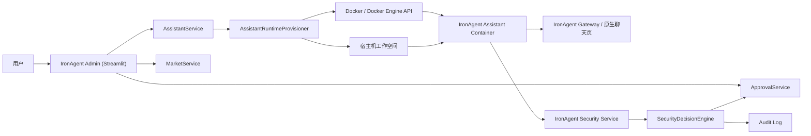

# IronAgent 当前项目架构总览

## 1. 文档目的

本文档用于总结 **当前版本** IronAgent 的真实项目架构，强调：

- 项目当前解决的核心问题
- 主要模块与职责边界
- 管理面、执行面、运行时三条主链路
- 与 `ironagent-main` 的依赖关系
- 当前版本已经具备的能力与阶段性边界

这是一份“**现状总结文档**”，重点是帮助团队快速理解现在这套系统到底由哪些部分构成、它们如何协同工作、后续应该从哪里继续演进。

## 2. 项目定位

IronAgent 不是一个独立的大模型聊天前端，而是一个围绕 IronAgent 构建的 **企业级助手管理与安全控制层**。

当前版本的核心定位可以概括为：

- 用 IronAgent 管理多个助手实例
- 每个助手对应一个独立 Docker 容器
- 每个助手拥有独立工作空间
- IronAgent 运行在助手容器中，负责模型推理、原生聊天页面、工具执行
- IronAgent 负责安全决策、审批、审计、市场、工作空间编排与后台管理

因此，当前系统是一个“双层结构”：

- **IronAgent**：负责“运行助手”
- **IronAgent**：负责“管理和约束助手”

## 3. 总体架构

### 3.1 架构分层

当前版本可以拆成四层：

1. **管理层**
   - Streamlit 后台
   - 助手管理
   - 市场管理
   - 审批管理
   - 审计查看

2. **安全决策层**
   - FastAPI 安全服务
   - `pre-execute` / `post-execute` hook
   - 路径与命令风险识别
   - 审批请求创建
   - 审计事件落盘

3. **运行时编排层**
   - 助手工作空间创建
   - Docker 容器创建、启动、重启、探活、销毁
   - IronAgent 配置注入
   - 网关 URL / token 生成与回写

4. **助手执行层**
   - 每个助手的 IronAgent 容器
   - 原生聊天页面
   - 模型调用
   - 工具执行
   - 工作空间读写

### 3.2 架构关系图



### 3.3 go-gateway 北向层与 K8s 部署形态

在上述四层之外，仓库还有一个 Go 实现的北向网关 `go-gateway/`：

- 对 IM / 上游系统提供统一 HTTP 入口（chat、tasks、approvals、files 等北向 API）
- 南向对接 Python 管理面（admin / security-service）

线上 K8s 形态为“单入口”部署：只对外暴露 Go Gateway，Admin / Security Service / IronAgent / MySQL 都是集群内部服务，每个助手一个 K8s Pod，工作空间走共享 PVC subPath。

本文不展开细节，专项文档见：

- `docs/go-gateway/`：网关集成、测试与部署专项文档
- `docs/ironagent-k8s-single-entry-full-deploy-runbook.zh-CN.md`：K8s 单入口全量部署手册

## 4. 当前仓库核心目录

当前 `src/` 下的主要模块如下：

```text
src/
  admin/               # Streamlit 管理后台
  approval/            # 审批数据模型与服务
  assistants/          # 助手记录、工作空间项目管理、运行时修复/重启
  market/              # skill/plugin 市场、上传、安装、下载
  runtime/             # Docker 编排、IronAgent 配置生成、探活、销毁
  security/            # 能力配置、请求策略、路径/命令判断
  security_service/    # FastAPI 安全服务与 hook API
  shared/              # 全局配置、JSON 存储、工作空间根目录解析
  workspace/           # 文件自动落点与工作空间语义规则
```

可以把它们理解成：

- `admin`：给人看的页面
- `security_service`：给 IronAgent hook 调用的 HTTP 服务
- `runtime`：负责真正“起容器”
- `assistants`：负责把“助手”这个业务对象和运行时绑定起来
- `market`：负责 skill / plugin 的市场分发与装配
- `security` + `workspace`：负责安全判断和工作空间规则

## 5. 核心模块职责

### 5.1 `src/admin`

这是 IronAgent 的管理后台，技术栈是 Streamlit。

当前主要页面包括：

- `assistants`
  - 创建/编辑助手
  - 选择模型接入方式
  - 配置工作空间根目录与目录名
  - 查看运行时状态
  - 重启、修复、删除助手
  - 查看助手已安装的 skills / plugins
  - 启用 / 停用 / 复用技能与插件
- `market`
  - 上传 skill / plugin 包
  - 审核
  - 下载归档
  - 安装到指定助手
- `approval`
  - 查看用户审批和管理员审批
  - 执行 allow / deny
- `audit_log`
  - 查看执行审计
- `dashboard`
  - 查看助手、审批、审计等总览指标

### 5.2 `src/security_service`

这是运行中的 FastAPI 服务，是 IronAgent 的“执行面入口”。

它主要提供：

- `/health`
- `/api/v1/hooks/pre-execute`
- `/api/v1/hooks/post-execute`
- `/api/v1/assistants/{assistant_id}`
- `/api/v1/approvals/{approval_id}`
- `/api/v1/market/...`

其中最关键的是：

- **pre-execute**
  - IronAgent 在工具执行前调用
  - IronAgent 在这里做 `allow / deny / pending_approval`
- **post-execute**
  - IronAgent 在工具执行后回调
  - IronAgent 在这里做审计落盘

### 5.3 `src/runtime`

这是当前版本最关键的底层模块，负责把“助手记录”变成“实际运行中的容器”。

当前主要职责包括：

- 创建工作空间目录
- 生成状态目录
- 生成并写入 IronAgent 配置
- 创建 Docker 容器
- 绑定状态目录与工作空间目录
- 启动、重启、探活、销毁容器
- 生成并回写：
  - `container_name`
  - `container_id`
  - `gateway_url`
  - `gateway_token`
  - `runtime_status`

当前实现同时支持：

- Docker CLI
- Docker Engine API（当容器内没有 CLI、但能访问 Docker socket 时）

### 5.4 `src/assistants`

这是“业务助手层”。

它管理的是“助手记录”，不是 Docker 容器本身。

主要职责：

- 助手 JSON 持久化
- 新建/更新助手
- 调用 `runtime.provisioner` 自动编排运行时
- 运行时探活和状态回写
- 一键修复运行时状态
- 一键重启助手
- 删除助手时同时清理：
  - 记录
  - 容器
  - 工作空间
  - 状态目录
- 管理助手工作空间中的：
  - skills
  - plugins
  - 停用目录 `.ironagent-disabled`

### 5.5 `src/market`

这是当前系统里的内部市场模块。

它的核心能力不是“直接让 IronAgent 去联网找技能”，而是：

- 在 IronAgent 里维护一套内部可控的 skill / plugin 仓库
- 支持上传、审核、下载
- 支持安装到指定助手工作空间

当前链路分两层：

1. **全局市场层**
   - `data/market/catalog.json`
   - `data/market/packages/...`

2. **助手装配层**
   - 把 skill / plugin 解压/复制到对应助手工作空间
   - 路径类似：
     - `.../skills/<slug>/`
     - `.../plugins/<slug>/`

这意味着：

- 上传是“进入全局市场”
- 安装才是“和某个助手绑定”

### 5.6 `src/security`

这是当前版本的策略判断层。

它负责两类逻辑：

1. **能力配置层**
   - `chat`
   - `onlyread`
   - `onlywrite`
   - `dangerous`

2. **请求策略层**
   - 敏感路径直接拒绝
   - `persistent/` 删除走用户审批
   - 第三方命令、外部 API、安装命令走管理员审批

当前生效方式是：

- 能力档位提供基础能力范围
- 路径/命令规则做最终裁决

### 5.7 `src/workspace`

这是工作空间语义层。

它现在主要解决一个问题：

- 当助手用工具写文件时，自动判断应该把输出重写到 `temp/` 还是 `persistent/`

当前这套“自动放置”仅作用于：

- `write`
- `edit`
- `apply_patch`

也就是说：

- 助手工具生成文件时，可以自动改写目标路径
- 宿主机手工拖文件到工作空间时，不会自动分拣

### 5.8 `src/approval`

审批模块的存储跟随全局 `IRON_AGENT_STORAGE_BACKEND`：默认使用 MySQL，设为 `json` 时回退到 JSON 文件存储。

它负责：

- 创建审批请求
- 按 `user / admin` 分类
- 查询 pending 状态
- 处理 allow / deny

它是当前安全链路里的中间状态承载层。

## 6. 当前数据存储结构

当前版本默认以 MySQL 为主存储（compose 默认 `IRON_AGENT_STORAGE_BACKEND=mysql`），助手、审批、审计、市场 catalog、工作空间文件元数据等结构化数据都落在数据库中，表结构由 Alembic 迁移管理（`migrations/versions/`，当前 head 为 027）。将 `IRON_AGENT_STORAGE_BACKEND` 设为 `json` 时可回退到 JSON 文件存储。

文件系统侧仍承载运行时状态、工作空间与市场包文件，主要数据目录包括：

```text
data/
  assistants/     # 助手记录（仅 json 后端使用）
  approvals/      # 审批请求（仅 json 后端使用）
  audit/          # 审计日志（仅 json 后端使用）
  runtimes/       # 每个助手的状态目录
  workspaces/     # 每个助手的共享工作空间
  market/         # 市场包与 catalog（catalog 仅 json 后端使用，包文件始终在此）
```

其中最关键的是：

- MySQL 中的助手记录（json 后端时为 `assistants.json`）
  - 管理面“助手”的业务真相
- `data/runtimes/<assistant_id>/`
  - 运行时状态、IronAgent 状态目录
- `data/workspaces/<assistant_id>/`
  - 宿主机与容器共享的工作空间

## 7. 工作空间架构

### 7.1 基本模型

每个助手都有一个独立工作空间：

```text
<workspace_root>/<workspace_slug>
```

该目录会被 bind mount 到容器内：

```text
/home/node/.ironagent/workspace
```

因此宿主机与容器看到的是同一份文件。

### 7.2 当前目录语义

默认目录结构为：

```text
workspace/
  USER.md
  AGENTS.md
  temp/
  persistent/
  skills/
  plugins/
```

其中：

- `temp/`
  - 临时文件、中间产物、缓存结果
- `persistent/`
  - 需要保留的业务文件
- `skills/`
  - 安装到该助手的 skill
- `plugins/`
  - 安装到该助手的 plugin

### 7.3 当前共享语义

这套工作空间已经具备“宿主机与容器助手进行文件交换”的能力：

- 宿主机直接往目录里复制/拖拽文件
- 容器内助手直接读取
- 助手输出文件后宿主机直接可见

当前版本还没有做的是：

- 页面内直接拖拽上传到工作空间
- 人工拖入文件的 `temp/persistent` 自动分类

## 8. 助手运行链路

当前主链路如下：

1. 用户在 `Assistants` 页面创建或编辑助手
2. `AssistantService` 合并业务配置
3. `AssistantRuntimeProvisioner`：
   - 计算工作空间路径
   - 创建状态目录
   - 生成 IronAgent 配置
   - 创建并启动容器
4. Docker 启动对应 IronAgent 助手容器
5. IronAgent 回写运行时信息到助手记录
6. 管理后台展示：
   - `runtime_status`
   - `container_name`
   - `workspace_root`
   - `gateway_url`
   - `gateway_token`

这是当前版本最重要的主线，也是整个系统的基础。

## 9. 安全与审批链路

当前执行链路如下：

1. 用户在原生 IronAgent 聊天页发起请求
2. 模型准备调用工具
3. IronAgent 触发 `pre-execute` hook
4. IronAgent `SecurityDecisionEngine` 做决策
5. 返回：
   - `allow`
   - `deny`
   - `pending_approval`
6. 如需审批，则创建审批记录
7. 执行结束后通过 `post-execute` 落审计日志

### 9.1 当前主要规则

**直接拒绝**

- 工作空间敏感文件写/删
  - `AGENTS.md`
  - `USER.md`
  - `.env`
- 容器敏感路径写/删
  - `/etc/**`
  - `/usr/local/bin/**`
  - `/app/**`
- 容器密钥路径访问
  - `/root/.ssh/**`

**用户审批**

- 删除 `persistent/` 中的文件

**管理员审批**

- 第三方命令
- 外部 API 命令
- 包安装命令
- 插件安装命令

**直接放行**

- 容器内普通命令
- 工作空间普通读写
- `temp/` 清理

## 10. 市场与助手装配链路

当前链路是：

1. 在 `Market` 页面上传 skill / plugin 包
2. 写入全局市场目录
3. 审核通过
4. 安装到指定助手
5. 包落到该助手自己的工作空间
6. 该助手容器通过工作空间挂载看到对应 skill / plugin

当前还支持：

- 下载归档包
- 在助手侧查看已安装的 skill / plugin
- 停用 / 启用
- 复用到另一个助手

## 11. 与 `ironagent-main` 的关系

这是当前架构里非常关键的一点。

### 11.1 `ironagent-main` 提供什么

`ironagent-main` 当前提供：

- IronAgent 原生运行时源码
- 原生聊天页面源码
- Docker 镜像构建来源
- 默认种子 skill 来源

### 11.2 当前依赖方式

IronAgent 当前并没有内置一份 IronAgent 源码，而是通过：

- `IRON_AGENT_RUNTIME_SOURCE_ROOT`
- `ironagent-runtime:dev`

来依赖 `ironagent-main`。

因此：

- IronAgent 自己有管理后台
- 原生聊天页面仍然来自 IronAgent
- 助手容器运行的镜像也来自 IronAgent

### 11.3 当前边界

这意味着：

- 改 Streamlit 后台：改 `ironagent`
- 改原生聊天页：改 `ironagent-main`

## 12. 当前版本的优点

当前架构的优点主要有：

- 每个助手容器隔离，边界清楚
- 工作空间可共享，便于宿主机与助手交换文件
- 安全决策与助手执行解耦
- 审批、审计、市场都已经有清晰落点
- 可以在不改 IronAgent 主逻辑的前提下做企业化外层改造

## 13. 当前版本的局限

当前版本仍然有一些明显的阶段性边界：

- 原生聊天页面还未并入 IronAgent，只是通过网关 URL / token 使用
- 页面内还没有“直接上传到工作空间”的能力
- 人工拖入工作空间的文件还不能自动判断进 `temp` 还是 `persistent`
- 市场对 skill 包结构仍然有格式约束
- 对 `ironagent-main` 仍有镜像与种子 skill 层面的依赖

## 14. 当前版本最准确的理解

如果要用一句话总结当前架构，可以这样描述：

> IronAgent 当前是一个围绕 IronAgent 构建的企业级控制层。它通过 Streamlit 后台管理助手实例，通过 FastAPI 安全服务接管工具执行前后的安全决策，通过 Docker 为每个助手编排独立容器，通过共享工作空间承载宿主机与助手之间的文件交换，并通过内部市场为每个助手分发 skill 与 plugin。

## 15. 建议阅读顺序

如果团队成员需要继续接手，推荐按这个顺序阅读：

1. 本文档：理解当前整体架构
2. `docs/archive/historical/technical-design.zh-CN.md`（已归档）：理解设计目标与阶段策略
3. `docs/workspace-selection-and-placement-design.zh-CN.md`：理解工作空间专项设计
4. `docs/market-skill-plugin-operation.zh-CN.md`：理解市场与助手装配
5. `docs/other-machine-runbook.zh-CN.md`：理解完整部署和运行流程
6. `docs/functional-test.zh-CN.md`：理解当前验收方式
