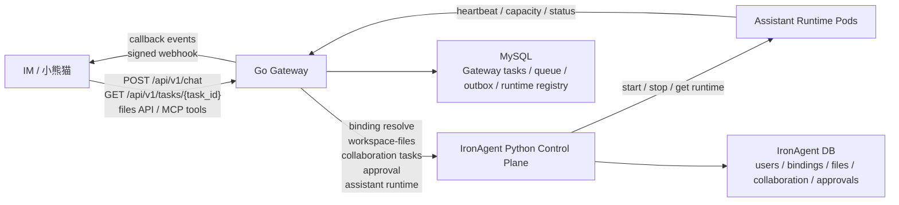
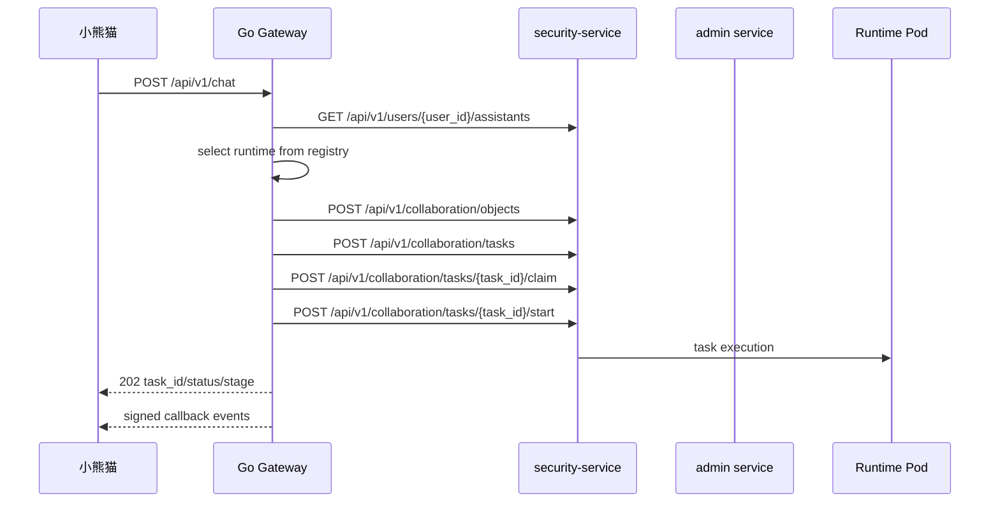
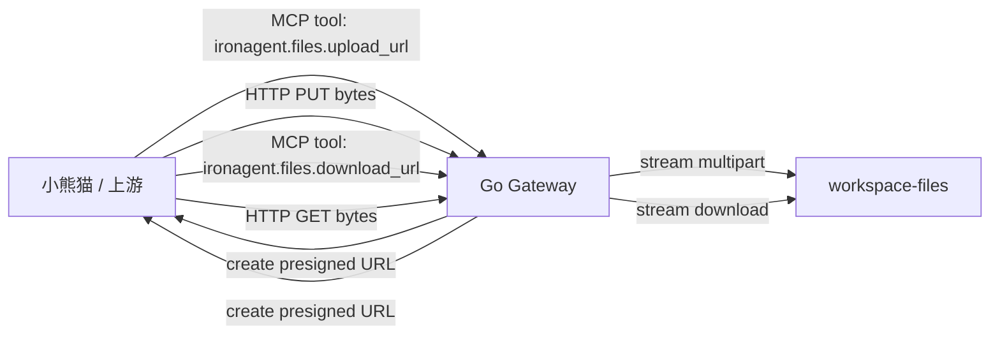

# Go Gateway Integration And Production Deployment

更新日期：2026-06-11

## 1. 文档用途

本文整理 Go Gateway 与上下游系统的逻辑关系，以及测试环境/线上环境的部署步骤。

适用范围：

- IronAgent / 小熊猫到 Go Gateway 的 northbound 对接。
- Go Gateway 到 IronAgent Python control plane 的 southbound 对接。
- Gateway 自身的持久化、鉴权、文件、Webhook、Runtime Registry、Metrics。
- 测试环境到线上环境的发布检查。

不适用范围：

- 不重新定义小熊猫 IM 平台内部实现。
- 不把 IronAgent collaboration task、claim token、workspace-files 原始结构暴露给上游。
- 不把本地开发配置直接当生产配置使用。

## 2. 总体逻辑关系



核心原则：

- 小熊猫只看外部任务模型，不理解 `claim_token`。
- Go Gateway 是 northbound 安全入口和 southbound 编排层。
- Python control plane 是现有能力来源，不直接暴露给外部。
- 文件内容不进任务 JSON，不进 callback，不进 MCP payload。
- 任务状态推送优先走 Webhook，`GET /api/v1/tasks/{task_id}` 只作为 fallback-query。

## 3. 职责边界

| 组件 | 职责 | 不负责 |
| --- | --- | --- |
| 小熊猫 / IM | 收发用户消息、上传原始文件、调用 Gateway、接收 callback、fallback 查询 | 不理解 IronAgent 内部任务模型，不处理 `claim_token` |
| Go Gateway | 绑定解析、任务创建、runtime 调度、HTTP 文件接口、Webhook outbox、统一状态模型 | 不直接执行 LLM，不把内部权限给外部 |
| IronAgent security-service | 用户绑定、workspace-files、collaboration object/task、approval query | 不直接暴露给小熊猫 |
| IronAgent admin service | approval resolve、assistant runtime start/stop | K8s Service 名为 `admin`，不作为公网入口 |
| Assistant Runtime Pod | 执行 IronAgent 任务、提供 runtime gateway、上报状态 | 不直接接收小熊猫请求 |
| MySQL | Gateway task store、queue、idempotency、webhook outbox、runtime registry | 不替代对象存储或文件字节流 |

## 4. Northbound 对接模型

### 4.1 小熊猫提交任务

入口：

```text
POST /api/v1/chat
```

外部字段：

```json
{
  "request_id": "req_20260426_001",
  "user_id": "e2e-main-0416",
  "conversation_id": "conv_001",
  "message": "帮我分析这份文件",
  "files": ["file_001"]
}
```

Gateway 返回：

```json
{
  "task_id": "gw_or_southbound_task_id",
  "status": "processing",
  "stage": "queued",
  "created_at": "2026-04-26T13:00:00Z"
}
```

要求：

- `request_id` 是上游幂等键。
- callback 地址由 Gateway 配置项 `GO_GATEWAY_DEFAULT_CALLBACK_URL` 提供，不从 `POST /api/v1/chat` 请求体读取。
- Gateway 不返回 `claim_token`、`target_assistant_id`、`input_object_id`。

### 4.2 小熊猫查询兜底状态

入口：

```text
GET /api/v1/tasks/{task_id}
```

外部响应：

```json
{
  "taskId": "task_001",
  "status": "processing",
  "stage": "tool_running",
  "replyText": "",
  "files": [],
  "errorCode": "",
  "errorMessage": "",
  "errorReason": ""
}
```

### 4.3 Gateway 推送 callback

callback body 按小熊猫接口文档只包含任务状态、阶段、结果和文件摘要。对外不暴露内部事件 ID、事件类型、事件序号或 callback 签名 header：

```json
{
  "taskId": "task_001",
  "status": "completed",
  "stage": "done",
  "replyText": "处理完成",
  "files": [
    {
      "fileId": "file_001",
      "fileName": "result.txt",
      "size": "128",
      "mimeType": "text/plain"
    }
  ]
}
```

要求：

- Gateway 只判断小熊猫 callback 接口 HTTP 状态码；返回 2xx 即视为本次推送成功，不要求 ACK body。
- callback 失败后由 Gateway outbox retry。
- 超过最大尝试次数后进入 dead-letter。

## 5. Southbound 编排模型



真实 southbound seam：

| 能力 | Python 接口 |
| --- | --- |
| 绑定解析 | `GET /api/v1/users/{user_id}/assistants` |
| 文件上传 | `POST /api/v1/workspace-files/upload` |
| 文件列表 | `GET /api/v1/workspace-files` |
| 文件下载 | `GET /api/v1/workspace-files/{file_id}/download` |
| 对象注册 | `POST /api/v1/collaboration/objects` |
| 任务创建 | `POST /api/v1/collaboration/tasks` |
| claim token | `POST /api/v1/collaboration/tasks/{task_id}/claim` |
| 启动任务 | `POST /api/v1/collaboration/tasks/{task_id}/start` |
| 查询任务 | `GET /api/v1/collaboration/tasks/{task_id}` |
| 取消任务 | `POST /api/v1/collaboration/tasks/{task_id}/cancel` |
| 查询审批 | `GET /api/v1/approvals/{approval_id}` |
| 审批决策 | `POST /api/v1/admin/approvals/{approval_id}/resolve` |
| runtime start | `POST /api/v1/admin/assistants/{assistant_id}/start` |
| runtime stop | `POST /api/v1/admin/assistants/{assistant_id}/stop` |
| runtime get | `GET /api/v1/assistants/{assistant_id}` |

要求：

- Gateway 负责注入 `X-IronAgent-Internal-Token`（取自 `GO_GATEWAY_INTERNAL_SERVICE_TOKEN`）。
- Python control plane 不应直接暴露到公网。
- `claim_token` 只存在于 Gateway 内部流程。

## 6. 文件链路



MCP 工具：

```text
ironagent.files.upload_url
ironagent.files.download_url
ironagent.files.get
ironagent.files.list
ironagent.files.delete
```

原则：

- MCP 只做文件管理，不传文件内容。
- 文件字节流只走 presigned HTTP `PUT / GET`。
- Gateway 上传和下载路径使用流式转发。
- 默认文件上限为 `50MiB`，由 `GO_GATEWAY_MAX_UPLOAD_BYTES` 控制。

## 7. 线上部署拓扑

推荐拓扑：

```text
Internet / IM 内网
  -> TLS Ingress / API Gateway
  -> Go Gateway Service
  -> IronAgent security-service / admin 内网服务
  -> Assistant Runtime Pods
  -> MySQL
```

当前能力边界：

- Go Gateway 当前统一的是任务、文件管理、callback/fallback、runtime registry 等控制面入口。
- Go Gateway 当前还没有实现 assistant runtime 原生 Web/UI/API 的统一反向代理。
- 因此，`只开放一个端口即可访问所有助手/功能` 仍是目标态，不是当前已交付状态。
- 如果要达到单端口目标，需要在 Go Gateway 增加 runtime proxy，或在 Ingress/API Gateway 层按路径/host 统一转发到 Go Gateway、IronAgent gateway 和 assistant runtime。

网络要求：

- 目标态只有统一入口对上游开放。
- 当前测试环境仍可能临时开放 Go Gateway 与 IronAgent gateway 的多个入口。
- `security-service` 和 `admin` 只允许 Gateway 内网访问。
- Runtime Pod heartbeat 只访问 Gateway runtime scope 接口。
- MySQL 只允许 Gateway 和 Python control plane 访问。

## 8. 线上配置

### 8.1 必填配置

```text
GO_GATEWAY_LISTEN_ADDR=:8080
GO_GATEWAY_MODE=polling
GO_GATEWAY_SECURITY_BASE_URL=http://security-service:8000
GO_GATEWAY_ADMIN_BASE_URL=http://admin:8501
GO_GATEWAY_INTERNAL_SERVICE_TOKEN=<secret>
GO_GATEWAY_DATABASE_URL=mysql+pymysql://<user>:<password>@<host>:<port>/<db>?charset=utf8mb4
GO_GATEWAY_PUBLIC_BASE_URL=https://gateway.example.com
GO_GATEWAY_PUBLIC_AUTH_DISABLED=false
GO_GATEWAY_SCOPED_API_KEYS=public-key:public;runtime-key:runtime;debug-key:debug;admin-key:admin;proxy-key:proxy
GO_GATEWAY_HMAC_SECRET=<secret>
GO_GATEWAY_CALLBACK_CLIENT_ID=ironagent-gateway
GO_GATEWAY_CALLBACK_SECRET=<secret>
GO_GATEWAY_DEFAULT_CALLBACK_URL=https://xiaoxiongmao.example.com/taskcallback
GO_GATEWAY_CALLBACK_ALLOWED_HOSTS=xiaoxiongmao.example.com
GO_GATEWAY_CALLBACK_ALLOW_PRIVATE_HOSTS=false
GO_GATEWAY_PRESIGN_SECRET=<secret>
GO_GATEWAY_PROXY_SESSION_SECRET=<secret>
GO_GATEWAY_PROXY_SESSION_TTL=30m
GO_GATEWAY_PROXY_MAX_IN_FLIGHT=1000
GO_GATEWAY_PROXY_FAILURE_THRESHOLD=3
GO_GATEWAY_PROXY_CIRCUIT_OPEN_DURATION=30s
GO_GATEWAY_MAX_UPLOAD_BYTES=52428800
GO_GATEWAY_RUNTIME_HEARTBEAT_TTL=60s
GO_GATEWAY_TASK_WORKER_ENABLED=true
GO_GATEWAY_TASK_QUEUE_MAX_PENDING=10000
```

以上只列与对接和安全直接相关的核心项。Gateway 当前共有 99 个 `GO_GATEWAY_*` 配置（含 r11 新增的 `GO_GATEWAY_PROCESS_ROLE`、`GO_GATEWAY_TASK_WORKER_CONCURRENCY`、`GO_GATEWAY_REDIS_*`、`GO_GATEWAY_CALLBACK_ACCEPT_ANY_RESPONSE` 等），完整字典、默认值与校验约束以 `go-gateway/docs/observability-runbook.md` §9 为准，本文不再维护全量清单。其中 `GO_GATEWAY_INTERNAL_SERVICE_TOKEN` 为必填（southbound 内部鉴权；K8s 部署由 `control-plane-shared-secret` 的 `IRON_AGENT_INTERNAL_SERVICE_TOKEN` 注入），`GO_GATEWAY_API_KEYS` 或 `GO_GATEWAY_SCOPED_API_KEYS` 必须至少配置一个 key。

K8s 清单中的非 secret 默认值已经写入：

```text
deployment/kustomize/ironagent/base/go-gateway-file-configmap.yaml
deployment/kustomize/ironagent/base/go-gateway-configmap.yaml
deployment/kustomize/ironagent/base/go-gateway-secret.example.yaml
```

`go-gateway-file-configmap.yaml` 会挂载到 `/etc/ironagent/go-gateway.json`，`go-gateway-configmap.yaml` 通过 `GO_GATEWAY_CONFIG_FILE=/etc/ironagent/go-gateway.json` 显式启用该文件。环境变量仍然可以覆盖配置文件。

`go-gateway-secret` 不在 `base` 中生成，避免 `kubectl apply -k` 把真实 Secret 覆盖成占位值。上线前必须先用 Kubernetes Secret、CI secret 或 Secret Manager 创建同名 `go-gateway-secret`。`go-gateway-secret.example.yaml` 只作为字段参考，不参与 Kustomize 渲染。Go Gateway 容器启动时会检查这些占位值，发现 `CHANGE_ME`、`REPLACE_ME` 或示例数据库串会直接退出，避免占位 secret 被误部署成可运行服务。

### 8.2 API Key scope 建议

```text
GO_GATEWAY_SCOPED_API_KEYS=public-key:public;runtime-key:runtime;debug-key:debug;admin-key:admin;proxy-key:proxy
```

当前基线部署为 `GO_GATEWAY_PUBLIC_AUTH_DISABLED=false`：上游 public 接口必须携带 `public` scope 的 `X-API-Key`；配置了 `GO_GATEWAY_HMAC_SECRET` 时，携带 API Key 的请求还必须带 HMAC 签名头。只有显式设置 `GO_GATEWAY_PUBLIC_AUTH_DISABLED=true` 时，public 路由才允许免鉴权访问。

scope 用途：

| scope | 用途 |
| --- | --- |
| public | northbound public 接口（`/api/v1/chat`、任务查询/取消、文件 presign 等） |
| runtime | Runtime Registry 与 heartbeat |
| debug | metrics、queue、scheduler debug |
| admin | runtime start/stop、dead-letter replay、内部验证接口 |
| proxy | `/assistants/{assistant_id}/api/*` Runtime API 代理；UI 入口优先使用 launch ticket/session |

### 8.3 配置挂载

配置文件路径：

```text
/etc/ironagent/go-gateway.json
```

容器挂载示例：

```bash
docker run --rm \
  -p 8080:8080 \
  -v /secure/go-gateway.json:/etc/ironagent/go-gateway.json:ro \
  ironagent-go-gateway
```

要求：

- 真实 secret 不写入 Git。
- 生产使用 Secret Manager / Kubernetes Secret / CI secret 注入。
- 环境变量可以覆盖配置文件。

### 8.4 K8s 清单

当前仓库已提供可执行清单：

```text
deployment/kustomize/ironagent/base/go-gateway-file-configmap.yaml
deployment/kustomize/ironagent/base/go-gateway-deployment.yaml
deployment/kustomize/ironagent/base/go-gateway-service.yaml
deployment/kustomize/ironagent/base/go-gateway-configmap.yaml
deployment/kustomize/ironagent/base/go-gateway-secret.example.yaml
deployment/kustomize/ironagent/overlays/prod-nodeport/secret/*.env
deployment/kustomize/ironagent/overlays/prod-ingress/secret/*.env
```

overlay 下的 `secret/*.env` 是控制面和 IronAgent Gateway 的占位文件，只用于让 `kubectl kustomize` 能执行。正式部署前必须用真实 Secret 值替换。Go Gateway 使用独立的 `go-gateway-secret`，需要在 `kubectl apply -k` 之前单独创建或由 CI/CD 注入。

对应 Service：

```text
http://go-gateway:8080
```

线上 southbound Service 地址：

```text
GO_GATEWAY_SECURITY_BASE_URL=http://security-service:8000
GO_GATEWAY_ADMIN_BASE_URL=http://admin:8501
```

prod-nodeport overlay 只暴露：

```text
go-gateway:30808
```

浏览器控制面、助手运行时控制桥和 Gateway API 均应经由 Go Gateway 入口访问。
`ironagent-gateway`、`admin` 与 `security-service` 保持 `ClusterIP`，不再通过 prod-nodeport 对外暴露。

当前 `prod-nodeport` 临时验证 overlay 已额外设置：

```text
GO_GATEWAY_PUBLIC_BASE_URL=http://<node-public-ip>:30808
GO_GATEWAY_RUNTIME_SYNC_INTERVAL=5s
```

`prod-k8s-single-entry-nodeport` 验证 overlay 还会设置：

```text
GO_GATEWAY_RUNTIME_DISCOVER_ASSISTANTS=true
```

该配置由 Gateway 周期性从 security-service 的 assistant context 发现运行中 assistant，再同步真实 runtime 状态，避免把 `demo-main` 这类测试助手硬编码进 runtime registry。

如果服务器 IP 或 NodePort 改变，需要同步修改：

```text
deployment/kustomize/ironagent/overlays/prod-nodeport/go-gateway-nodeport-config-patch.yaml
```

NodePort 测试环境现在默认只开放 Go Gateway 一个外部 NodePort。推荐使用 `prod-nodeport`：

```bash
kubectl kustomize deployment/kustomize/ironagent/overlays/prod-nodeport > /tmp/ironagent-prod-nodeport.yaml
kubectl diff -f /tmp/ironagent-prod-nodeport.yaml
kubectl apply -f /tmp/ironagent-prod-nodeport.yaml
```

`prod-single-entry-nodeport` 作为兼容 overlay 保留，行为同样是单入口：

```bash
kubectl kustomize deployment/kustomize/ironagent/overlays/prod-single-entry-nodeport > /tmp/ironagent-prod-single-entry-nodeport.yaml
kubectl diff -f /tmp/ironagent-prod-single-entry-nodeport.yaml
kubectl apply -f /tmp/ironagent-prod-single-entry-nodeport.yaml
```

该 overlay 只把 `go-gateway` 暴露为 NodePort `30808`，`ironagent-gateway`、`admin`、`security-service` 仍保持内部服务。

`GO_GATEWAY_RUNTIME_DISCOVER_ASSISTANTS` 只用于当前测试环境和 K8s runtime 验证 overlay，生产不要依赖它支撑 500-2000 runtime。生产应由 runtime Pod 或 sidecar 持续 heartbeat；`GO_GATEWAY_RUNTIME_BOOTSTRAP_ASSISTANTS` 仅保留为本地或手工验证兜底，列表只能写真实存在且 runtime 为 `running` 的 assistant。

对应的控制面环境变量也必须保持内部地址：

```text
IRON_AGENT_RUNTIME_HOOK_SERVICE_URL=http://security-service:8000
IRON_AGENT_GO_GATEWAY_PUBLIC_URL=http://<gateway-public-host>:30808
IRON_AGENT_SECURITY_SERVICE_PUBLIC_URL=
IRON_AGENT_SECURITY_SERVICE_INTERNAL_URL=http://security-service:8000
```

如果 assistant runtime 不在 Kubernetes Service 网络内，不能重新打开 `security-service` 公网入口；应通过私有网络、mesh、专用内网 Ingress 或 runtime sidecar 解决访问路径。

## 9. 数据库迁移

推荐在 `admin` 容器中执行迁移，因为该容器已经具备 Python 运行时、项目代码和数据库网络访问。

K8s 执行方式：

```bash
kubectl -n ironagent exec deploy/admin -- sh -lc '
  cd /app &&
  PYTHONPATH=/app \
  .venv/bin/alembic -c migrations/alembic.ini upgrade head
'
```

如果在本地或 CI 执行，需要显式注入线上数据库地址：

```bash
cd <repo-root>
IRON_AGENT_DATABASE_URL='mysql+pymysql://<user>:<url-encoded-password>@<host>:<port>/<db>?charset=utf8mb4' \
PYTHONPATH=$(pwd) \
uv run alembic -c migrations/alembic.ini upgrade head
```

必须创建的 Gateway 表：

```text
gateway_tasks
gateway_idempotency_keys
gateway_task_events
gateway_task_queue
gateway_event_sequences
gateway_event_outbox
gateway_webhook_deliveries
gateway_dead_letters
gateway_runtimes
gateway_runtime_heartbeats
```

其中 `gateway_runtimes` 与 `gateway_runtime_heartbeats` 需要包含 Runtime Proxy 目标字段：

```text
internal_base_url
gateway_url
```

旧测试库可能已经存在部分表，但缺少新代码需要的兼容列。迁移后必须额外检查：

```sql
SELECT version_num FROM alembic_version;

SELECT COLUMN_NAME
FROM INFORMATION_SCHEMA.COLUMNS
WHERE TABLE_SCHEMA = DATABASE()
  AND TABLE_NAME = 'gateway_tasks'
  AND COLUMN_NAME IN ('client_id', 'status', 'stage', 'fallback_query_url', 'metadata_json');

SELECT COLUMN_NAME, IS_NULLABLE, COLUMN_DEFAULT
FROM INFORMATION_SCHEMA.COLUMNS
WHERE TABLE_SCHEMA = DATABASE()
  AND TABLE_NAME = 'workspace_files'
  AND COLUMN_NAME IN ('storage_provider', 'checksum');

SELECT COLUMN_NAME
FROM INFORMATION_SCHEMA.COLUMNS
WHERE TABLE_SCHEMA = DATABASE()
  AND TABLE_NAME = 'external_push_requests'
  AND COLUMN_NAME IN ('storage_backend', 'storage_key', 'storage_url');
```

验收标准：

- `alembic_version` 至少到 `012_repair_workspace_file_legacy_defaults`。
- `gateway_tasks` 包含 `client_id/status/stage/fallback_query_url/metadata_json`。
- `workspace_files.storage_provider` 与 `workspace_files.checksum` 均为非空列，并有空字符串默认值。
- `external_push_requests.storage_backend/storage_key/storage_url` 均存在。
- 只有应急抢修时才允许手动修表或手动 stamp Alembic；正常部署必须通过镜像内迁移脚本完成。

验收：

- Gateway 启动时 `GO_GATEWAY_DATABASE_URL` 能连接成功。
- task、queue、outbox、runtime registry 都使用 MySQL store。
- 重启 Gateway 后任务、outbox、runtime registry 不丢失。

回滚策略：

- 优先回滚 Gateway 镜像，不优先回滚数据库。
- 如果必须回滚迁移，且确认没有新版本 Gateway 继续写入这些表，可执行：

```bash
kubectl -n ironagent exec deploy/admin -- sh -lc '
  cd /app &&
  PYTHONPATH=/app \
  .venv/bin/alembic -c migrations/alembic.ini downgrade 009_merge_workspace_file_heads
'
```

- 生产回滚前需要先停止 Gateway 写流量或切走入口流量。

## 10. 测试环境部署与生产前检查

当前文档可以作为测试环境部署手册使用；不建议不经二次生产评审直接作为生产发布手册。生产入口还需要完成真实 runtime heartbeat producer、正式域名/TLS/入口鉴权，以及完整容量报告。

### 10.1 发布前检查

```bash
cd <repo-root>
(cd go-gateway && go test -count=1 ./...)
(cd go-gateway && go vet ./...)
git diff --check
kubectl kustomize deployment/kustomize/ironagent/overlays/prod-nodeport >/tmp/go-gateway-prod-nodeport.yaml
kubectl kustomize deployment/kustomize/ironagent/overlays/prod-ingress >/tmp/go-gateway-prod-ingress.yaml
if grep -R -E -n 'CHANGE_ME|REPLACE_ME' \
  deployment/kustomize/ironagent/overlays/prod-nodeport/config \
  deployment/kustomize/ironagent/overlays/prod-nodeport/secret \
  deployment/kustomize/ironagent/overlays/prod-ingress/config \
  deployment/kustomize/ironagent/overlays/prod-ingress/secret; then
  echo 'overlay files still contain placeholders' >&2
  exit 1
fi
if grep -E -n 'v0\.0\.0-replace-me|registry\.example\.com' /tmp/go-gateway-prod-nodeport.yaml /tmp/go-gateway-prod-ingress.yaml; then
  echo 'rendered manifests still contain placeholders' >&2
  exit 1
fi
```

检查项：

- 已替换 Go Gateway 镜像为不可变版本 tag。
- 已创建真实 `go-gateway-secret`，不再使用 `CHANGE_ME_*` 或 `REPLACE_ME_*`。
- `prod-nodeport` 的 `GO_GATEWAY_PUBLIC_BASE_URL` 已改成当前测试入口。
- 已执行 Alembic 迁移。
- 测试入口只开放 `30808`；`30789`、`30790`、`30800`、`30880` 不再作为公网 NodePort 暴露。
- `GO_GATEWAY_PUBLIC_BASE_URL` 已配置。
- `GO_GATEWAY_PUBLIC_AUTH_DISABLED` 与上游约定一致；当前基线为 `false`，上游 public 接口需携带 `public` scope 的 API Key 与 HMAC 签名头。
- `GO_GATEWAY_CALLBACK_ALLOWED_HOSTS` 只包含小熊猫正式 callback 域名。
- `GO_GATEWAY_CALLBACK_ALLOW_PRIVATE_HOSTS=false`。
- `GO_GATEWAY_HMAC_SECRET`、`GO_GATEWAY_CALLBACK_SECRET`、`GO_GATEWAY_PRESIGN_SECRET`、`GO_GATEWAY_PROXY_SESSION_SECRET` 不为空；配置 HMAC secret 后，所有携带 `X-API-Key` 的请求都要求 HMAC 签名头。
- Python southbound 只在内网可访问。
- Prometheus 已配置 `/metrics` 抓取。

创建或更新 Go Gateway Secret：

```bash
kubectl -n ironagent create secret generic go-gateway-secret \
  --from-literal=GO_GATEWAY_DATABASE_URL='mysql+pymysql://<user>:<url-encoded-password>@<host>:<port>/<db>?charset=utf8mb4' \
  --from-literal=GO_GATEWAY_SCOPED_API_KEYS='public-key:public;runtime-key:runtime;debug-key:debug;admin-key:admin;proxy-key:proxy' \
  --from-literal=GO_GATEWAY_HMAC_SECRET='<hmac-secret>' \
  --from-literal=GO_GATEWAY_CALLBACK_SECRET='<callback-secret>' \
  --from-literal=GO_GATEWAY_PRESIGN_SECRET='<presign-secret>' \
  --from-literal=GO_GATEWAY_PROXY_SESSION_SECRET='<proxy-session-secret>' \
  --dry-run=client -o yaml | kubectl apply -f -
```

`GO_GATEWAY_INTERNAL_SERVICE_TOKEN` 不放在 `go-gateway-secret`：Deployment 从 `control-plane-shared-secret` 的 `IRON_AGENT_INTERNAL_SERVICE_TOKEN` 注入，需保证该 secret 与控制面使用同一 token。

### 10.2 构建镜像

仓库已提供 Dockerfile：

```text
go-gateway/Dockerfile
```

构建示例：

```bash
cd <repo-root>
IMAGE=registry.example.com/ironagent/go-gateway:v20260427-<gitsha>
docker build -t "$IMAGE" -f go-gateway/Dockerfile .
docker push "$IMAGE"
```

本地二进制构建方式：

```bash
cd go-gateway
CGO_ENABLED=0 GOOS=linux GOARCH=amd64 go build -o bin/go-gateway ./cmd/server
```

K8s 镜像名默认写在：

```text
deployment/kustomize/ironagent/base/go-gateway-deployment.yaml
deployment/kustomize/ironagent/overlays/runtime-common/kustomization.yaml
```

发布时需要把 `registry.example.com/ironagent/go-gateway:v0.0.0-replace-me` 替换为实际镜像仓库和不可变版本 tag；不要在生产使用 `latest`。

### 10.3 部署顺序

推荐顺序：

1. 部署或确认 MySQL 可用。
2. 创建或更新真实 `go-gateway-secret`。
3. 执行 Alembic migration。
4. 部署 Python `security-service` 和 `admin`。
5. 部署 Go Gateway 单副本。
6. 启动 assistant runtime，并确保 runtime heartbeat / registry 已写入 Gateway。
7. 开放测试入口 `30808`，不要开放 `30789`、`30790`、`30800`、`30880`。
8. 验证 `/healthz`、`/readyz`、`/api/v1/health`。
9. 验证小熊猫 callback allowlist。
10. 执行一条 `POST /api/v1/chat` smoke test。
11. 确认 callback HTTP 2xx 投递成功。
12. 扩容 Gateway 或 runtime pool。

K8s 应用示例：

```bash
kubectl kustomize deployment/kustomize/ironagent/overlays/prod-ingress >/tmp/ironagent-prod-ingress.yaml
kubectl apply -k deployment/kustomize/ironagent/overlays/prod-ingress
```

NodePort 临时验证示例：

```bash
kubectl kustomize deployment/kustomize/ironagent/overlays/prod-nodeport >/tmp/ironagent-prod-nodeport.yaml
kubectl apply -k deployment/kustomize/ironagent/overlays/prod-nodeport
```

注意：

- `prod-nodeport` 是当前测试环境的单 NodePort 方案，只暴露 Go Gateway `30808`。
- 线上正式环境仍推荐使用 `prod-ingress` 或平台 API Gateway，并保持单公网入口。
- `admin` 与 `security-service` 不应通过 NodePort 或公网 Ingress 暴露。

### 10.4 K8s Probe 与 `/readyz` 分工

K8s Deployment 的 readiness probe 使用 `/healthz`，不是 `/readyz`。

原因：

- `/readyz` 会检查 Runtime Registry 至少有一个可用 runtime。
- 新部署时 runtime heartbeat 可能需要先通过 `go-gateway` Service 注册。
- 如果 K8s readiness 直接使用 `/readyz`，Gateway Pod 会因为 runtime 为空一直不进入 Service endpoints，runtime heartbeat 也无法首次注册，形成启动死锁。

因此：

- `/healthz` 用作 K8s 进程级 readiness，确保 Service endpoint 可被 runtime heartbeat 访问。
- `/readyz` 用作应用级严格验收，必须在 heartbeat 或测试 bootstrap 完成后返回 200。
- 对外放量前仍必须以 `/readyz = 200` 作为门禁。

### 10.5 Readiness 验收

```bash
curl https://gateway.example.com/healthz
curl https://gateway.example.com/readyz
scripts/go-gateway/hmac_request.py \
  --url https://gateway.example.com \
  --method GET \
  --path /metrics \
  --api-key <debug-key> \
  --client-id <client-id> \
  --secret <hmac-secret>
```

理想结果：

```text
/healthz = 200
/readyz = 200
go_gateway_health_ready 1
```

`/readyz` 必须同时满足：

- Gateway 进程存活。
- `southbound_security=up`。
- `southbound_admin=up`。
- Runtime Registry 至少有一个可用 runtime。
- task queue / outbox 没有不可恢复异常。

### 10.6 Runtime Registry 与 heartbeat

生产环境不要依赖 `GO_GATEWAY_RUNTIME_BOOTSTRAP_ASSISTANTS` 作为主要机制；它只适合本地或小规模测试环境。浏览器单入口访问 `/assistants/{assistant_id}/...` 时，Gateway 会在合法 launch ticket 解析成功后自动懒注册该 assistant 的 runtime，因此新增助手不需要写入 bootstrap 列表才能打开 WebUI。

生产推荐机制：

- Runtime Pod 或 runtime sidecar 定期调用 Gateway heartbeat 接口。
- heartbeat 间隔必须小于 `GO_GATEWAY_RUNTIME_HEARTBEAT_TTL`。
- Gateway 把 runtime 状态写入 MySQL `gateway_runtimes` 与 `gateway_runtime_heartbeats`。
- `/readyz` 依赖 Runtime Registry 判断是否有可用 runtime。

heartbeat 接口：

```text
POST /api/v1/runtime/registry/{assistant_id}/heartbeat
```

示例：

```bash
scripts/go-gateway/hmac_request.py \
  --url https://gateway.example.com \
  --method POST \
  --path /api/v1/runtime/registry/demo-approval/heartbeat \
  --api-key <runtime-key> \
  --client-id <client-id> \
  --secret <hmac-secret> \
  --json '{
    "runtime_id": "pod-uid-or-container-id",
    "pod_name": "assistant-demo-approval-xxx",
    "status": "running",
    "capacity": 10,
    "in_flight": 0,
    "capabilities": ["analysis", "chat"],
    "drain_mode": false,
    "last_error": ""
  }'
```

理想结果：

```json
{
  "runtime": {
    "assistant_id": "demo-approval",
    "status": "running",
    "capacity": 10,
    "in_flight": 0,
    "drain_mode": false
  }
```

如果没有 heartbeat：

- `gateway_runtimes` 为空或 runtime 被标记为 `unhealthy`。
- `/readyz` 会返回 `503`。
- `POST /api/v1/chat` 在未指定可用 target 时会失败。

本地或小规模临时验证可使用：

```text
GO_GATEWAY_RUNTIME_DISCOVER_ASSISTANTS=true
GO_GATEWAY_RUNTIME_SYNC_INTERVAL=5s
```

该方式由 Gateway 周期性从 Python control plane 的 assistant context 发现运行中 assistant，再同步真实 runtime 状态，不适合作为 500-2000 runtime 的正式注册机制。`GO_GATEWAY_RUNTIME_BOOTSTRAP_ASSISTANTS=<assistant_id>` 仍可用于本地或手工验证兜底，但不要作为生产主机制。

### 10.7 Smoke test

创建测试 object 后提交任务。当前基线 `GO_GATEWAY_PUBLIC_AUTH_DISABLED=false`，public 接口需携带 `public` scope key 与 HMAC 签名提交：

```bash
scripts/go-gateway/hmac_request.py \
  --url https://gateway.example.com \
  --method POST \
  --path /api/v1/chat \
  --api-key <public-key> \
  --client-id <client-id> \
  --secret <hmac-secret> \
  --json '{
    "request_id": "prod_smoke_001",
    "user_id": "test-user",
    "conversation_id": "smoke-conv",
    "message": "smoke test",
    "files": ["<file_id>"]
  }'
```

理想结果：

```json
{
  "task_id": "...",
  "status": "processing",
  "stage": "queued"
}
```

随后确认：

- 小熊猫收到 callback body，且 body 中 `taskId` 与 `POST /api/v1/chat` 返回的任务 ID 一致。
- 小熊猫 callback 接口返回 HTTP 2xx。
- fallback query 可查到同一 task，且返回体与 callback body 字段一致。
- metrics 中 webhook delivered 增长。
- 如果没有部署 runtime 完成任务回调，任务可能停留在 `processing/tool_running`。这只证明 southbound 编排已到 `claim/start`，不能作为业务回复完成验收。
- 完整业务闭环必须由 runtime 执行侧调用 `complete` 或 `fail`，或者在测试后调用 `POST /api/v1/tasks/{task_id}/cancel` 清理 smoke 任务。

## 11. 多副本与 500-2000 runtime 注意事项

当前可支持测试环境 500-2000 runtime 分发验证，但生产多 Gateway 横向扩容前必须确认：

- `GO_GATEWAY_DATABASE_URL` 已启用。
- task store、task queue、outbox、runtime registry 使用 MySQL。
- callback outbox worker 使用 lease 防止重复投递。
- runtime registry heartbeat 使用共享 DB。
- HMAC nonce 在 `GO_GATEWAY_DATABASE_URL` 启用后写入 MySQL `gateway_hmac_nonces`，可支持多 Gateway 严格防重放；未启用数据库时仍是单进程内存窗口，只适合本地或单副本测试。

建议路径：

1. 先单 Gateway + 多 runtime 验证。
2. 再多 Gateway + MySQL task/outbox/runtime registry/nonce store 验证。
3. 最后补入口层限流、TLS 和容量报告。

## 12. 监控与告警

必须采集：

```text
go_gateway_health_ready
go_gateway_runtime_registered_total
go_gateway_runtime_ready_total
go_gateway_runtime_in_flight_total
go_gateway_runtime_capacity_total
go_gateway_task_queue_active
go_gateway_task_queue_queued
go_gateway_scheduler_decisions_total
go_gateway_scheduler_latency_seconds_max
go_gateway_southbound_requests_total
go_gateway_southbound_errors_total
go_gateway_webhook_events_total
go_gateway_webhook_dead_letters_total
go_gateway_file_transfer_bytes_total
```

关键告警：

- `/readyz != 200` 持续超过 1 分钟。
- `go_gateway_runtime_ready_total == 0`。
- `go_gateway_task_queue_active` 持续上涨。
- `go_gateway_southbound_errors_total` 快速增长。
- `go_gateway_webhook_dead_letters_total` 增长。
- scheduler latency 持续升高。

## 13. 回滚策略

### 13.1 Gateway 回滚

条件：

- Gateway 自身启动失败。
- `/readyz` 持续失败且下游正常。
- callback 大量 dead-letter。
- task queue 快速积压。

操作：

1. 保留 MySQL 数据。
2. 回滚 Gateway 镜像到上一版本。
3. 保持 Python control plane 不变。
4. 通过 fallback query 验证既有 task 状态。

### 13.2 下游回滚

条件：

- `southbound_security=down` 或 `southbound_admin=down`。
- collaboration task 创建失败。
- approval resolve 失败。

操作：

1. 暂停 Gateway 新流量或开启入口限流。
2. 回滚 Python control plane。
3. 验证 `/api/v1/health`。
4. 恢复 Gateway 流量。

### 13.3 Callback 回滚

条件：

- 小熊猫 callback 持续 500 / timeout。
- 小熊猫 callback 持续返回非 2xx。

操作：

1. Gateway outbox 自动 retry。
2. 修复小熊猫 callback。
3. 使用 dead-letter replay 恢复投递。
4. fallback query 保底查状态。

## 14. 不能上线的条件

任一条件成立时不建议上线：

- `GO_GATEWAY_PUBLIC_BASE_URL` 未配置。
- `GO_GATEWAY_CALLBACK_ALLOW_PRIVATE_HOSTS=true` 出现在生产。
- `GO_GATEWAY_PUBLIC_AUTH_DISABLED=true` 出现在生产且未与上游接口约定显式对齐（public 路由免鉴权）。
- `GO_GATEWAY_HMAC_SECRET` 为空且需要保护内部 scope 接口。
- `GO_GATEWAY_DATABASE_URL` 未配置但计划多副本部署。
- `/readyz` 不是 200。
- Runtime Registry 没有 ready runtime。
- callback allowlist 没有限制到小熊猫正式域名。
- Python southbound 可被公网直接访问。
- 没有执行 `Go-Gateway-全流程测试手册.md` 的最小验收。
